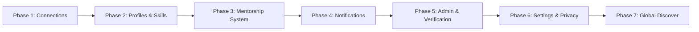

# SeniorSOS — Pending Core Features Implementation Plan

> **Scope**: Detailed roadmap and specification for all pending core functionalities in SeniorSOS based on the project specification ([project.md](file:///d:/SeniorSOS/Senior-SOS/project.md)) and PostgreSQL database schema ([schema.prisma](file:///d:/SeniorSOS/Senior-SOS/backend/prisma/schema.prisma)). *Neo4j graph database features are planned for a subsequent stage.*

---

## 📌 Executive Summary & Current Audit

### ✅ What is Currently Implemented:
* **Authentication**: JWT login, registration, refresh tokens, cookie auth, `/api/auth/me`.
* **User Discovery**: User listing and search endpoint (`GET /api/users`) with role/name filters.
* **Real-time Messaging**: Socket.IO real-time chat, MongoDB message document store, conversation switcher, user showcase modal.
* **Community Feed**: Post creation, comments, and post reactions stored in MongoDB document store.

---

## 🚀 Detailed Module Breakdown & Pending Features

---

### Phase 1: Connections & Networking System
> **Goal**: Replace unrestricted direct messaging with connection requests and network management.

#### 1. Database Schema & Models
* **Entities**: `ConnectionRequest` and `Connection` in PostgreSQL ([schema.prisma](file:///d:/SeniorSOS/Senior-SOS/backend/prisma/schema.prisma#L193-L225)).
* **Enums**: `RequestStatus` (`PENDING`, `ACCEPTED`, `REJECTED`, `CANCELLED`).

#### 2. Backend Module (`backend/src/modules/networking/`)
* **Routes & Controllers**:
  * `POST /api/connections/request` — Send connection request to a user.
  * `PUT /api/connections/request/:id/accept` — Accept incoming request (creates `Connection` row).
  * `PUT /api/connections/request/:id/reject` — Reject incoming request.
  * `DELETE /api/connections/request/:id` — Cancel pending sent request.
  * `GET /api/connections` — List active user connections.
  * `GET /api/connections/requests` — List incoming and outgoing pending requests.
  * `GET /api/connections/suggestions` — Suggested connections by department, graduation year, or role.
* **Services & Business Logic**:
  * Ensure user cannot connect with self.
  * Prevent duplicate pending requests using canonical pairs.
  * Enforce connection check helper `isUserConnected(userA, userB)`.

#### 3. Frontend UI (`frontend/src/features/networking/`)
* **Routes**: `/network`
* **Components & Views**:
  * **My Connections**: Grid/List of connected alumni and students with quick chat action.
  * **Incoming Requests**: Accept & Reject action cards.
  * **Sent Requests**: Status list with Cancel option.
  * **Network Suggestions**: Recommended member cards with "Connect" button.
* **Messaging Integration**: Update `/messages` to display connection status or prompt users to send a connection request first.

---

### Phase 2: User Profiles & Skill Management
> **Goal**: Complete profile views and editable self-profiles for students and alumni.

#### 1. Database Schema & Models
* **Entities**: `User`, `AcademicProfile`, `AlumniProfile`, `Department`, `Company`, `Skill`, `UserSkill`.

#### 2. Backend Module (`backend/src/modules/users/`)
* **Routes & Controllers**:
  * `GET /api/users/:id/profile` — Fetch full user profile with department, company, skills, and connection status.
  * `PUT /api/users/profile` — Update self-profile (Bio, Skills, Career Interests, Designation, Company, Experience).
  * `GET /api/departments` — List available departments.
  * `GET /api/companies` — Search or list registered companies.
  * `GET /api/skills` — List and search available skills.

#### 3. Frontend UI (`frontend/src/features/profile/`)
* **Routes**: `/profile` (Self Profile), `/profile/:userId` (Public Profile)
* **Components & Views**:
  * **Profile Header**: Name, avatar, role badge, department/designation, connection & message action buttons.
  * **About & Bio Section**: Bio summary, career interests.
  * **Experience & Education**: Academic background (graduation year, department) and Alumni professional background (company, designation, experience years).
  * **Skills Pills**: List of skills with proficiency levels.
  * **Profile Edit Modal / Drawer**: Form for editing profile details and adding skills with auto-complete.
  * **Profile Completion Bar**: Progress indicator (e.g. *80% complete*).

---

### Phase 3: Mentorship System
> **Goal**: Enable structured student-to-alumni mentorship workflows.

#### 1. Database Schema & Models
* **Entities**: `MentorshipRequest` in PostgreSQL ([schema.prisma](file:///d:/SeniorSOS/Senior-SOS/backend/prisma/schema.prisma#L231-L253)).
* **Enums**: `MentorshipStatus` (`PENDING`, `ACTIVE`, `REJECTED`, `CANCELLED`, `ENDED`), `MentorshipFrequency` (`ONE_TIME`, `WEEKLY`, `MONTHLY`).

#### 2. Backend Module (`backend/src/modules/mentorship/`)
* **Routes & Controllers**:
  * `POST /api/mentorship/request` — Create mentorship request.
  * `PUT /api/mentorship/requests/:id/accept` — Alumni accepts request (`ACTIVE`).
  * `PUT /api/mentorship/requests/:id/reject` — Alumni rejects request.
  * `PUT /api/mentorship/requests/:id/end` — End active mentorship.
  * `GET /api/mentorship/my-mentors` — List active/pending mentors for student.
  * `GET /api/mentorship/my-mentees` — List active/pending mentees for alumnus.
  * `GET /api/mentorship/discover` — Discover mentors filtered by focus area & industry.

#### 3. Frontend UI (`frontend/src/features/mentorship/`)
* **Routes**: `/mentorship`, `/mentorship/discover`, `/mentorship/request/:userId`
* **Components & Views**:
  * **Mentor Discovery Hub (`/mentorship/discover`)**: Filter mentors by focus area (*Backend Development, System Design, Placement Preparation, Career Guidance, Higher Studies*) and industry.
  * **Mentorship Request Modal/Form**: Form selecting focus area, help needed, personal goals, and preferred meeting frequency.
  * **Mentorship Dashboard (`/mentorship`)**:
    * **My Mentors Tab**: Active & pending mentors with quick chat button.
    * **My Mentees Tab**: Active & pending mentees with Accept/Reject actions.

---

### Phase 4: Notifications & Activity System
> **Goal**: In-app notifications and real-time alerts for user interactions.

#### 1. Database Schema & Models
* **Entities**: `Notification` ([schema.prisma](file:///d:/SeniorSOS/Senior-SOS/backend/prisma/schema.prisma#L300-L314)).

#### 2. Backend Module (`backend/src/modules/notifications/`)
* **Routes & Controllers**:
  * `GET /api/notifications` — Get user notifications (paginated).
  * `PATCH /api/notifications/:id/read` — Mark notification as read.
  * `PATCH /api/notifications/read-all` — Mark all notifications as read.
* **Notification Triggers**: Helper function `createNotification({ recipientId, actorId, type, payload })` triggered on:
  * Connection request received / accepted.
  * Mentorship request received / status updated.
  * New comment on post.

#### 3. Frontend UI (`frontend/src/features/notifications/`)
* **Routes**: `/notifications` + Navbar Header Dropdown
* **Components & Views**:
  * **Navbar Bell Icon**: Red badge counter for unread notifications.
  * **Notifications Drawer/Dropdown**: Quick preview of recent notifications.
  * **Notifications Center (`/notifications`)**: Grouped by *Today* and *Earlier* with filter tabs (All, Unread) and direct links to relevant pages.

---

### Phase 5: Admin Portal & Alumni Verification
> **Goal**: Platform moderation, user administration, and alumni verification queue.

#### 1. Database Schema & Models
* **Entities**: `VerificationStatus` (`PENDING`, `APPROVED`, `REJECTED`), `AccountStatus` (`ACTIVE`, `SUSPENDED`, `DEACTIVATED`), `AuditLog`.

#### 2. Backend Module (`backend/src/modules/admin/`)
* **Middleware**: `requireAdmin` role check.
* **Routes & Controllers**:
  * `GET /api/admin/stats` — Overview metrics (total users, alumni, pending verifications, active posts).
  * `GET /api/admin/users` — Paginated user list with status/role filters.
  * `PATCH /api/admin/users/:id/status` — Suspend or activate user account.
  * `GET /api/admin/verifications` — List pending alumni verification requests.
  * `PATCH /api/admin/verifications/:id` — Approve or reject alumni verification.
  * `GET /api/admin/reports` — Content & user moderation queue.
  * `GET /api/admin/audit-logs` — Audit log of admin actions.

#### 3. Frontend UI (`frontend/src/features/admin/`)
* **Routes**: `/admin`, `/admin/users`, `/admin/verification`, `/admin/moderation`
* **Components & Views**:
  * **Admin Overview Dashboard**: Summary stat cards and quick action queues.
  * **Alumni Verification Queue (`/admin/verification`)**: Card view showing alumni graduation, department, company proof, with Approve/Reject buttons.
  * **User Management Table (`/admin/users`)**: Searchable table with status toggles (Activate / Suspend).
  * **Verified Alumni Badge**: Verified shield icon displayed next to approved alumni names across the app.

---

### Phase 6: User Settings & Privacy Controls
> **Goal**: Allow users to manage account details, security, and privacy preferences.

#### 1. Database Schema & Models
* **Entities**: `UserSettings` ([schema.prisma](file:///d:/SeniorSOS/Senior-SOS/backend/prisma/schema.prisma#L316-L327)).

#### 2. Backend Module (`backend/src/modules/settings/`)
* **Routes & Controllers**:
  * `GET /api/settings` — Fetch user settings and privacy preferences.
  * `PUT /api/settings/privacy` — Update profile visibility (`COLLEGE` vs `CONNECTIONS_ONLY`).
  * `PUT /api/settings/notifications` — Update notification toggles.
  * `POST /api/auth/change-password` — Change password endpoint.

#### 3. Frontend UI (`frontend/src/features/settings/`)
* **Routes**: `/settings`
* **Components & Views**:
  * **Account Settings Tab**: Update basic contact details.
  * **Security Settings Tab**: Change password form, list active refresh tokens/sessions.
  * **Privacy Settings Tab**: Radio toggle for profile visibility.
  * **Notification Preferences Tab**: Toggle switches for Connection Requests, Messages, Mentorship Updates, and Community Activity.

---

### Phase 7: Global Discovery & Search Hub
> **Goal**: Dedicated network-wide discovery page with rich filtering.

#### 1. Backend Module (`backend/src/modules/users/`)
* Extend `GET /api/users` with filters: `departmentId`, `companyId`, `skillId`, `graduationYear`, `role`, and text search.

#### 2. Frontend UI (`frontend/src/features/discover/`)
* **Routes**: `/discover`
* **Components & Views**:
  * **Filter Sidebar**: Checkboxes & dropdowns for Role (Student/Alumni), Department, Company, Skills, and Graduation Year.
  * **Search Header**: Main search bar with instant query debouncing.
  * **Member Card Grid**: Rich cards with avatar, designation, department, skills tags, and "Connect" / "Message" actions.

---

## 📅 Suggested Phased Execution Order

---

## 🧪 Verification & Acceptance Checklist

1. **Connection Enforcement**: Verify non-connected users see a "Connect" prompt before direct chat.
2. **Profile Completion**: Verify updating profile reflects across feeds, message headers, and public profile views.
3. **Mentorship Flow**: Test student requesting mentorship ➔ alumnus receiving request ➔ accepting ➔ status updating to `ACTIVE`.
5. **Alumni Verification**: Verify admin approving alumni updates `verificationStatus` to `APPROVED` and shows verified badge.
6. **Notification Delivery**: Verify performing connection/mentorship actions triggers in-app notification count updates for recipient.
